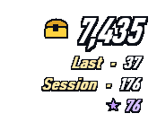
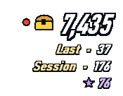
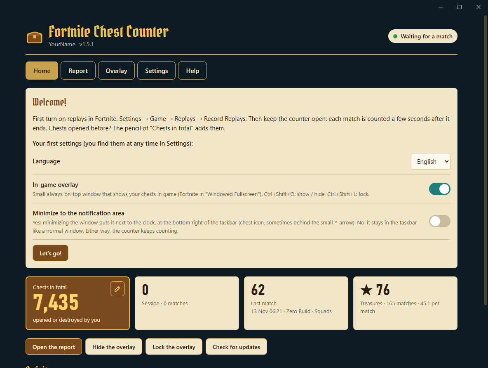
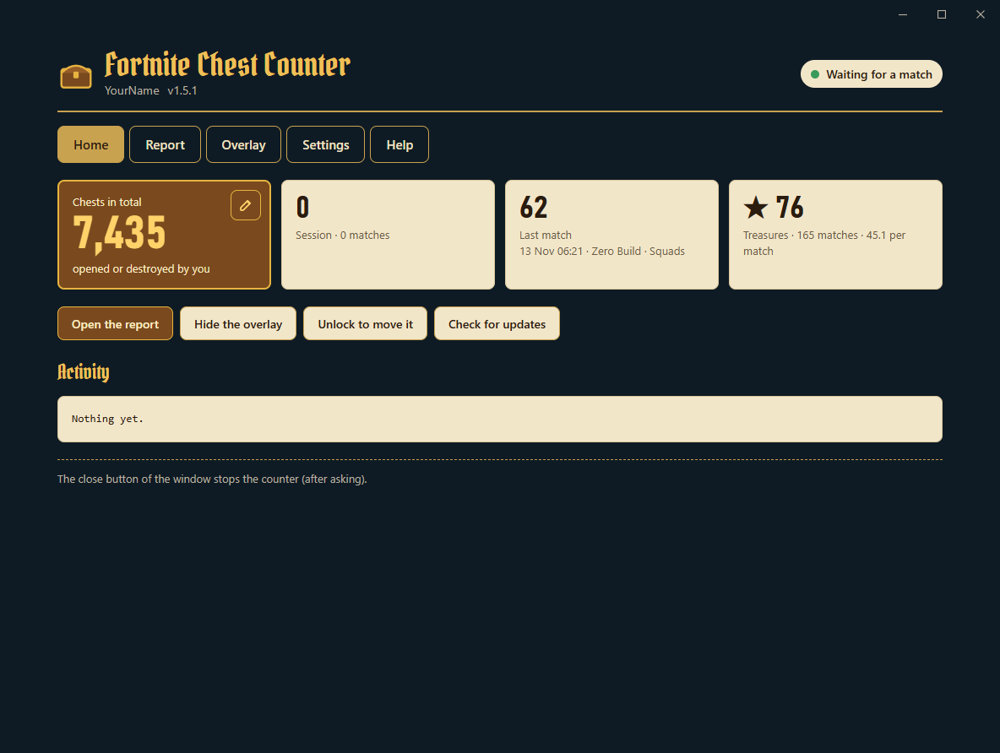
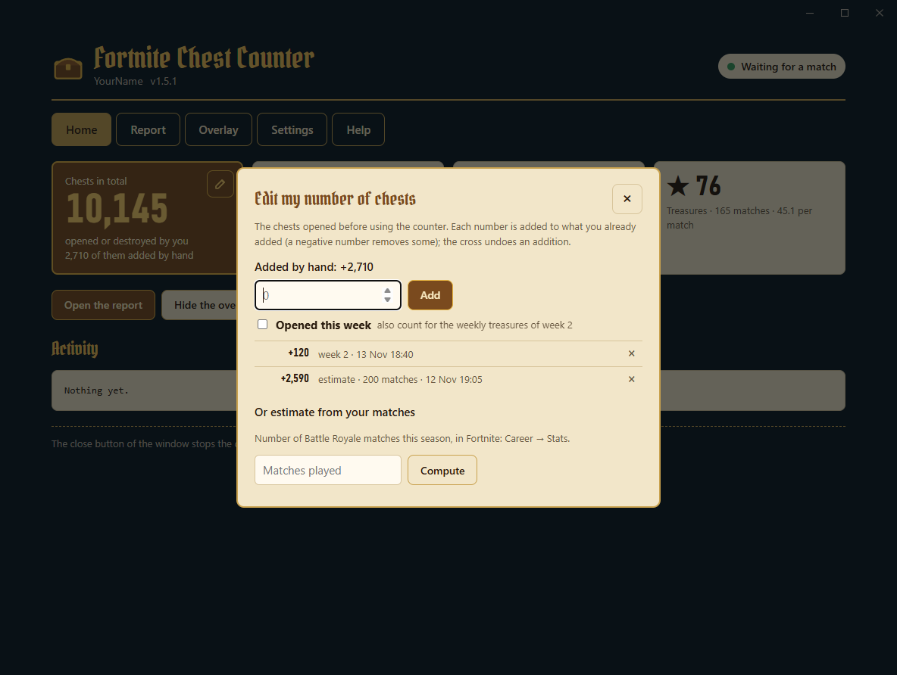
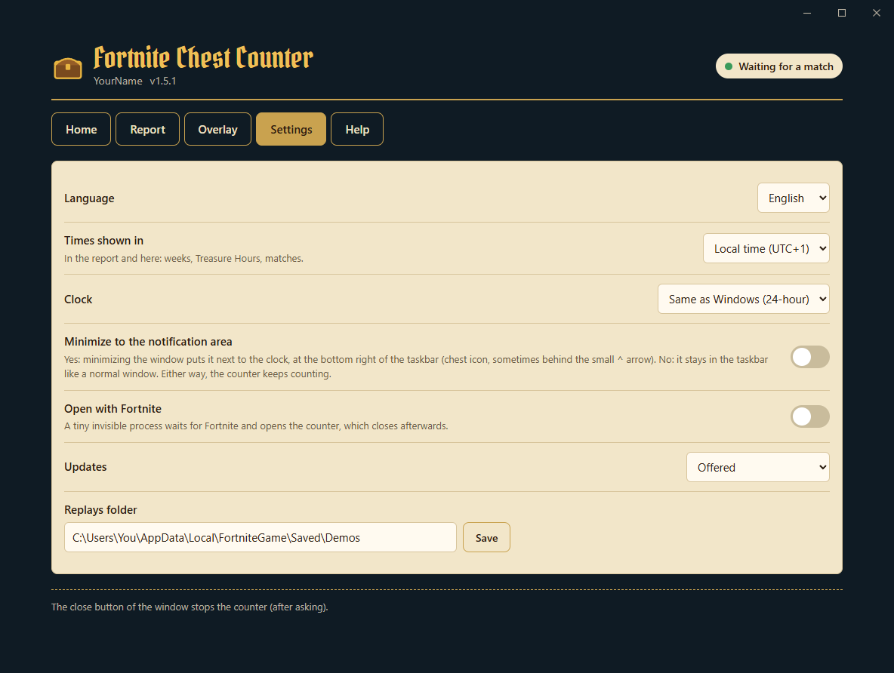
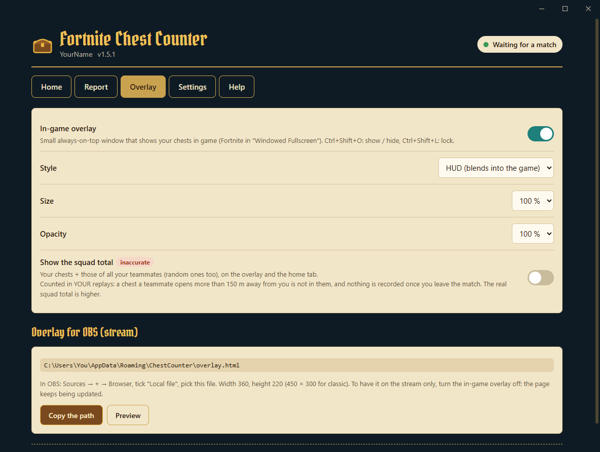
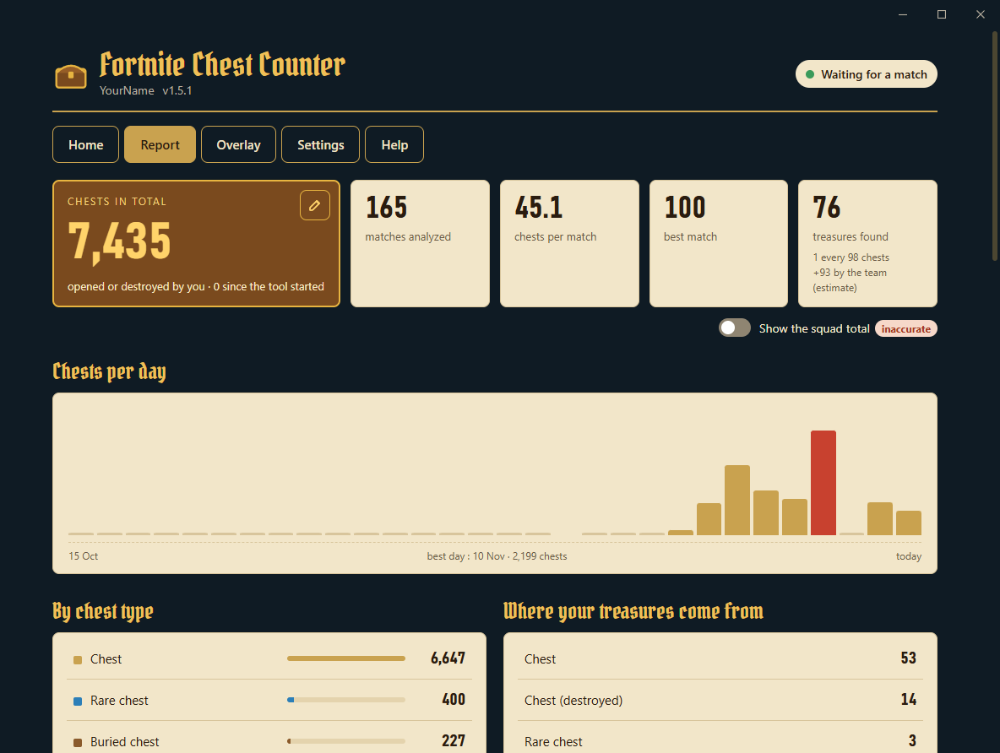
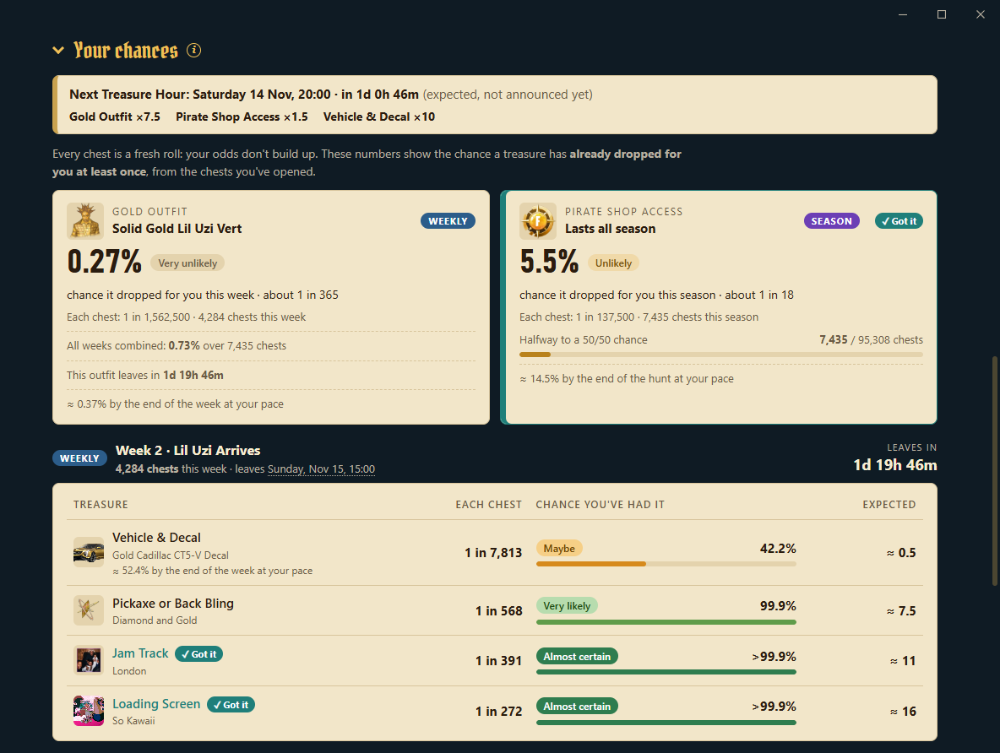

<div align="center">

**English** · [Русский](README.ru.md)


# Fortnite Chest Counter

[](../../releases/latest) [](../../releases)  [](LICENSE)

**Counts every chest you open in Fortnite, match after match, with an overlay that blends into the game.**

&nbsp;&nbsp;&nbsp;&nbsp;

[**⬇ Download ChestCounter.exe**](../../releases/latest) · Windows 10 / 11 · free · no install

</div>

---

Chest Counter reads the replays Fortnite saves after each match and keeps a running count of the chests you opened, along with the **treasure hunt treasures** you got from your chests. A transparent overlay shows your figures over the game, like the rest of the HUD, and the counter's window keeps your whole history, your chances of getting the gold outfit and your collection of treasures.

> It counts the chests **you opened**. It does not show where chests are on the map.

## How it works (and why it is safe)

Fortnite can record a **replay file** of every match on your PC. Chest Counter reads these files once the match is over, and nothing else.

- ✅ **Only reads replay files**: the `.replay` files Fortnite writes to `%LOCALAPPDATA%\FortniteGame\Saved\Demos`. They are opened read-only and never modified.
- ✅ **No game modification**: nothing in the Fortnite install folder is touched, no file is added or changed.
- ✅ **No access to the game's memory**: the tool never reads, writes or injects anything into the Fortnite process. It does not interact with the running game at all.
- ✅ **No data sent**: no login, no access to your Epic account, no telemetry. It only goes online to GitHub, to download: the treasure hunt data (weeks, odds, Treasure Hours, a few kilobytes at each start), the pictures of the treasure collection (once) and, unless you turn it off, a new version of the tool. Nothing is sent.
- ✅ **Nothing opened to the network**: the window shows a page that the counter serves to your PC only (`127.0.0.1`, with a random key).
- ✅ **Lightweight**: runs at low priority (and in "efficiency mode" on Windows 11), sleeps between matches, and the window's display engine is stopped while the window is in the notification area.

> [!IMPORTANT]
> **Replays must be turned on in Fortnite**: *Settings → Game → Replays → Record Replays: **On***. Without replays, the tool has nothing to read.

Because Fortnite only writes the replay's decryption key when the match ends, chests are counted **a few seconds after each match**, not during it. While you play, a **red dot** next to the overlay's total shows that a match is in progress.

## Getting started

1. Download **[`ChestCounter.exe`](../../releases/latest)**. This single file is all you need.
2. Turn on replays in Fortnite (see above).
3. Run `ChestCounter.exe`.
   > Windows may show *"Windows protected your PC"* because the exe is not signed. Click *More info → Run anyway*.
4. The counter's window opens. No questions to answer: the **Welcome** card sets the three things that matter (they stay in **Settings**), and the replays already on your PC are counted right away.

<p align="center"></p>

5. Keep the counter open while you play. You can minimize it: it keeps counting (in the taskbar, or next to the clock if you chose the notification area). A few seconds after each match, its chests are added.

> [!TIP]
> Fortnite only keeps a limited number of unsaved replays and deletes the oldest ones, and a match played while the counter is closed is not counted. Turn on **Settings → Open with Fortnite** so you never have to think about it.

## The window

Five tabs: **Home**, **Report**, **Overlay**, **Settings** and **Help**. At the top, your account and what the counter is doing (*Waiting for a match*, *Match in progress*, *Counting the chests…*).

- **Home**: your total, this session, your last match and your treasures, the buttons of the overlay and of the updates, and the activity (each match counted, or why one was skipped).
- **Report**: all your statistics (see below).
- **Overlay**: the in-game overlay and the page for OBS.
- **Settings**: language, times (local or UTC, 12- or 24-hour clock), notification area, open with Fortnite, updates, replays folder.
- **Help**: how it works, your data folder, the error log, a link to report a problem, and **Uninstall**.

<p align="center"></p>

The close button asks before stopping the counter (a match played while it is closed is not counted). Starting `ChestCounter.exe` again brings the window back to the front.

### Chests opened before the counter

Click the **pencil** of *Chests in total* (Home or Report) to add the chests you opened before using the counter. Each number you type is added to what you already added (a negative number removes some), and the list below shows every addition, with a **×** to undo it. Tick **Opened this week** for chests of the current week: they then count in this week's chances too. Don't know how many? Enter the number of matches shown in Fortnite (*Career → Stats*): the counter multiplies the matches it has not seen by your average (a new estimate replaces the previous one).

<p align="center"></p>

### Settings

<p align="center"></p>

| Setting | What it does |
|---|---|
| Language | English or Russian. |
| Times shown in | Local time (default) or UTC, for the weeks, Treasure Hours and matches. |
| Clock | Same as Windows (default), 12-hour or 24-hour. |
| Minimize to the notification area | Yes: minimizing the window puts it next to the clock, at the bottom right of the taskbar (chest icon, sometimes behind the small ^ arrow). No (default): it stays in the taskbar like a normal window. |
| Open with Fortnite | See below. |
| Updates | Offered (default), installed automatically or off. |
| Replays folder | Only change it if you moved it. |
| Account (profile) | Shown when several Fortnite accounts recorded replays on this PC. |

## Open with Fortnite

With this option, a tiny invisible process starts with Windows and checks every few seconds whether Fortnite is running. It reads nothing from the game: it only looks at the list of running programs. When Fortnite starts, it opens the counter minimized (the game keeps the screen). When Fortnite closes, the counter counts your last match, then closes 30 seconds later; **Keep the counter open** on the Home tab (or starting `ChestCounter.exe` again) keeps it open. Can be turned off at any time in **Settings**: the invisible process stops and is removed from the Windows startup. While the option is on, the invisible process keeps running after you quit the counter, so Windows refuses to delete or move `ChestCounter.exe`. Turn the option off first, or use **Help → Uninstall**.

## The overlay

Just the figures, outlined like the game's own, with no background: put it under the minimap and it blends into the HUD.

- **Big**: your **total** chests, with the golden chest. During a match, a **red dot** shows next to it (the match's chests are counted at the end).
- **Last**: the chests of your last match, still shown during the next one.
- **Session**: the chests since the counter was started.
- **★**: your treasures.

| Shortcut | What it does |
|---|---|
| **Ctrl+Shift+O** | Show / hide the overlay. Works anywhere, even in game. |
| **Ctrl+Shift+L** | Lock / unlock. **Locked**: the mouse goes through it (best in game). **Unlocked**: a background shows, hold the left mouse button to move it, right-click to hide it. |

To see it over the game, set Fortnite to **Windowed Fullscreen** (*Settings → Video → Window Mode*): in exclusive fullscreen, Windows cannot draw anything on top of the game. The **Overlay** tab turns it on or off and sets its style (HUD, or classic: a dark card with more details), its size and its opacity. **Show the squad total** adds a line with your chests + those of your teammates (off by default, and inaccurate: a chest a teammate opens more than 150 m away from you is not in your replays).

<p align="center"></p>

**Streaming (OBS).** The counter keeps writing `overlay.html` (data folder): the same figures, in the style you chose, with a transparent background, refreshed every 5 seconds. In OBS: *Sources → + → Browser*, tick *Local file*, pick `%APPDATA%\ChestCounter\overlay.html`, width 360 × height 220 (450 × 300 for the classic style). **Copy the path** in the Overlay tab copies it for you. Want it on the stream only, not on your screen? Turn off *In-game overlay*: the OBS page keeps being updated.

## The report

The **Report** tab updates by itself after each match: total, matches, average, best match, treasures (and **1 treasure every N chests**), chests per day, chest types and where your treasures come from. The switch under the figures adds the **squad total** (off by default). The long parts fold: click their title to open them.

<p align="center"></p>

- **Your chances** (open): the chance that each treasure has already dropped for you at least once, with a word for it (*Unlikely*, *Likely*, *Almost certain*…). A chest only gives the treasure of its week, so the **weekly** ones (gold outfit, vehicle & decal, pickaxe or back bling, jam track, loading screen) count this week's chests, with their picture and a countdown until they leave; the **Pirate Shop Access** and gizmos count the whole hunt. The odds are those published by Epic Games. During a **Treasure Hour**, chests count with their boosted odds, the banner shows the current or next one with a countdown, and the odds of the boosted treasures change live (in orange).
- **They got it in your matches** (experimental): the Pirate Shop Access and gold outfits that other players got near you.
- **Your collection**: this season's treasures, week by week, to tick what you obtained. A treasure from a golden chest seen in your replays is ticked by itself.
- **Treasures found** and **Latest matches**: every treasure and every match, 10 at a time.

<p align="center"></p>

The same report is also written to `report.html` (data folder), to open in a browser.

## Treasures

- **★★ Golden chest (certain).** When a chest gives a treasure hunt reward (cosmetic, jam track, loading screen, vehicle…), the server spawns a golden chest carrying the **prize id**. The tool reads it from the replay and names the prize.
- **★ Every treasure received (exact moment).** Each treasure you receive is recorded with its exact time and the chest it came from; it only counts if that chest is **yours**. When the item can be identified it is named; otherwise it shows as **"Treasure (unknown type)"** (golden firework, portable extractor, locators, extraction accelerator…), whose exact type is not in the replay.
- **Team treasures (estimate).** The treasure hunt shares every treasure with the whole team: the ones your teammates find can be shown in *Treasures found* (switch), marked with the team icon. They are deduced from the treasures you receive without opening a chest, and never count in your totals.
- A treasure that came from something other than a chest (ammo box…) is flagged with ⚑ and **low reliability**: it is most likely a mistake in reading the replay.

The game only sends prize ids, not names: the names, the weeks, the odds and the Treasure Hours come from [`content/content.json`](https://github.com/LED-N/Fortnite-ChestCounter/blob/main/content/content.json) of the original project, read from GitHub at each start, so that a new week shows up without a new version of the tool.

## Profiles (several accounts on one PC)

The replays saved on a PC are normally its player's: **no name to type**, the tool counts the player who recorded each replay. If it finds replays from several accounts, each account gets its own profile with its own statistics, and a list next to the name, at the top of the window, switches between them. After a match on another account, the counter follows that account by itself. A match played on another account is saved in that account's profile, never lost.

## Updates

At startup, the counter checks GitHub for a new version. If there is one, the Home tab shows **what's new in your language**, with **Install**: it is downloaded, verified, and the counter restarts. Your history and settings are kept. After the update, the Home tab shows once what has changed. **Check for updates** asks GitHub again at any time. In the settings you can choose *offered* (default), *installed automatically* (only between two matches) or *off* (no update check).

## Your data

Everything is stored in `%APPDATA%\ChestCounter` (**Help → Open the data folder**):

| File | Content |
|---|---|
| `data.json` | Your whole history. **Back it up** if you change PC. |
| `config.json` | Your settings, your profile, the overlay position. |
| `report.html` | The report, to open in a browser. |
| `overlay.html` | Transparent overlay for OBS. |
| `matches.csv` | One line per match, for Excel or Google Sheets. |
| `content.json`, `images\` | The treasure hunt data and pictures downloaded from GitHub. |
| `webview\` | The data of the window's display engine. |
| `errors.log` | Details of unreadable replays, to attach to a bug report. |

To start over, delete this folder (or keep `data.json` to keep your history). If you used the old version (ChestTracker), your `%APPDATA%\ChestTracker` folder is taken over automatically.

## FAQ

**Nothing is counted.** Check that replays are turned on in Fortnite, and that the counter is running when the match ends. The top of the window tells you if the replays folder is missing, and the activity on the Home tab says why a match was skipped.

**Are ammo boxes counted?** No. Ammo boxes, food boxes and loot cannons are not part of the chest total. Chests you **destroy** instead of opening are counted. A chest that is refilled during the match and that you open again counts once more; coming back near a chest you already opened (dug-up buried chest, sprite chest) does not count it twice.

**Which modes are counted?** Only **Battle Royale on the season's map** (build and zero build, solo to squads), where the chest treasure hunt runs. Not counted: ranked, OG, Reload, Blitz and other limited-time modes, Creative and UEFN islands, LEGO, Festival, private matches. The counter reads the map and the mode from each replay; a skipped match says why in the activity.

**A match with ⚠ in the report?** Fortnite did not record what your vehicle destroyed in that replay: chest loot was seen along your drive with no chest recorded, so those chests cannot be counted. The ⚠ says what to do.

**Fortnite closed in the middle of a match.** Its replay is incomplete (Fortnite never wrote the decryption key): that match cannot be counted, and the tool shows it as an "incomplete replay".

**"Cannot read this replay".** A Fortnite update can change the replay format; the parser then needs an update. Matches already counted are kept. [Open an issue](../../issues) with `errors.log` attached (**Help → Open the error log**).

**I can't delete `ChestCounter.exe` ("the file is open in another program"): why?** With **Open with Fortnite** on, a small invisible process keeps using the exe, even with the counter closed. Two ways out:
- **Help → Uninstall ChestCounter**: it turns the option off, closes the counter and deletes the exe. You choose whether to keep your history and settings (`%APPDATA%\ChestCounter`, handy if you reinstall later) or to delete everything.
- Or set **Settings → Open with Fortnite** to *off*, close the counter, then delete `ChestCounter.exe` yourself.

**Where did the window go?** With **Settings → Minimize to the notification area** on, a minimized counter is next to the clock, at the bottom right of the taskbar (chest icon, sometimes behind the small ^ arrow); a click on it opens it again. Starting `ChestCounter.exe` again also brings it back.

**The window stays blank or opens in my browser.** The window uses Microsoft Edge WebView2, built into Windows 11 and installed on almost every Windows 10. Without it, the counter opens the same page in your browser. You can install it from [Microsoft](https://developer.microsoft.com/microsoft-edge/webview2/) (*Evergreen Bootstrapper*).

**Already open?** Only one counter can run at a time: starting it again brings the open window to the front.

**Can a match be counted twice?** No, even if you rename or save the replay.

## Command line options

```
ChestCounter.exe --lang <en|ru>      change the language
ChestCounter.exe --demos <folder>    another replays folder
ChestCounter.exe --data <folder>     another data folder
ChestCounter.exe --once              analyze the finished replays, then quit (writes into the terminal)
ChestCounter.exe --reset-config      forget the settings (your history is kept)
ChestCounter.exe --overlay-preview <file.png>   save previews of the overlay, then quit
```

## Build it yourself

Install the [.NET 10 SDK](https://dotnet.microsoft.com/download/dotnet/10.0) (Windows x64), then double-click **`build.bat`**: the exe is written to `dist\ChestCounter.exe`. Tests: `dotnet test tests/ChestCounter.Tests`. The GitHub Actions workflow runs the tests and builds the exe on every push, and attaches it to a release when a `v*` tag is pushed, with the text of [`RELEASE_NOTES.md`](RELEASE_NOTES.md) (also shown in the counter after an update).

## License and credits

[MIT](LICENSE). English + Russian fork of [LED-N/Fortnite-ChestCounter](https://github.com/LED-N/Fortnite-ChestCounter), whose treasure hunt data and pictures it uses. Replay reading is based on [FortniteReplayDecompressor](https://github.com/Shiqan/FortniteReplayDecompressor) by Shiqan (MIT), slightly modified: see [`lib/PATCHES.md`](lib/PATCHES.md). The window uses [Microsoft Edge WebView2](https://developer.microsoft.com/microsoft-edge/webview2/). The headings use the [Pirata One](https://fonts.google.com/specimen/Pirata+One) font (SIL Open Font License, [`src/ChestCounter/Assets/PirataOne-OFL.txt`](src/ChestCounter/Assets/PirataOne-OFL.txt)). Treasure pictures and schedule: [fortnite.bot](https://fortnite.bot). Thanks to [koiseka](https://github.com/koiseka) for their counting fixes ([#6](../../pull/6)).

This project is not affiliated with, endorsed or sponsored by Epic Games. Fortnite is a trademark of Epic Games, Inc.
