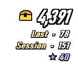
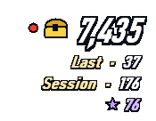
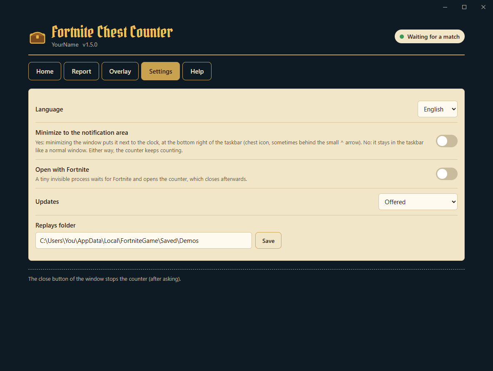
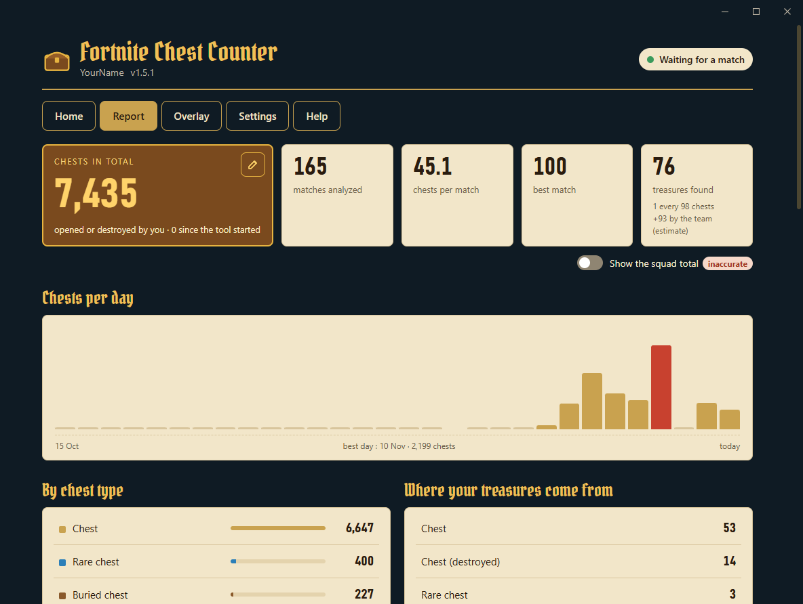

<div align="center">

[English](README.md) · **Русский**


# Счётчик сундуков Fortnite

[](../../releases/latest) [](../../releases)  [](LICENSE)

**Считает каждый сундук, который ты открываешь в Fortnite, матч за матчем, с оверлеем, который сливается с игрой.**

&nbsp;&nbsp;&nbsp;&nbsp;

[**⬇ Скачать ChestCounter.exe**](../../releases/latest) · Windows 10 / 11 · бесплатно · без установки

</div>

---

Счётчик сундуков читает повторы, которые Fortnite сохраняет после каждого матча, и ведёт общий счёт открытых тобой сундуков, а также **сокровищ из охоты за сокровищами**, полученных из твоих сундуков. Прозрачный оверлей показывает цифры поверх игры, как остальной HUD, а подробный отчёт хранит всю историю.

> Он считает сундуки, которые **открыл ты**. Он не показывает, где сундуки находятся на карте.

> Снимки экрана ниже сделаны в английской версии.

## Как это работает (и почему это безопасно)

Fortnite может записывать на твой ПК **файл повтора** каждого матча. Счётчик читает эти файлы после окончания матча, и больше ничего.

- ✅ **Только чтение файлов повторов**: файлы `.replay`, которые Fortnite пишет в `%LOCALAPPDATA%\FortniteGame\Saved\Demos`. Они открываются только для чтения и никогда не изменяются.
- ✅ **Никаких изменений игры**: в папке установки Fortnite ничего не трогается, файлы не добавляются и не меняются.
- ✅ **Никакого доступа к памяти игры**: программа ничего не читает, не пишет и не внедряет в процесс Fortnite. Она вообще не взаимодействует с запущенной игрой.
- ✅ **Данные никуда не отправляются**: без входа в аккаунт, без доступа к аккаунту Epic, без телеметрии. Единственное обращение к сети — проверка новой версии на GitHub, её можно отключить в настройках.
- ✅ **Лёгкая**: работает с низким приоритетом (и в «режиме эффективности» в Windows 11), спит между матчами, а оверлей перерисовывается только при изменении числа.

> [!IMPORTANT]
> **В Fortnite должна быть включена запись повторов**: *Настройки → Игра → Повторы → Записывать повторы: **Вкл.*** Без повторов программе нечего читать.

Fortnite записывает ключ расшифровки повтора только в конце матча, поэтому сундуки подсчитываются **через несколько секунд после каждого матча**, а не во время него. Пока ты играешь, оверлей показывает **● В матче**.

## Начало работы

1. Скачай **[`ChestCounter.exe`](../../releases/latest)**. Этот единственный файл — всё, что нужно.
2. Включи запись повторов в Fortnite (см. выше).
3. Запусти `ChestCounter.exe`.
   > Windows может показать *«Система Windows защитила ваш компьютер»*, потому что exe не подписан. Нажми *Подробнее → Выполнить в любом случае*.
4. Короткая настройка (стрелки + Enter) спросит **язык** (английский / русский), проверит **папку с повторами**, предложит посчитать **повторы, уже лежащие на ПК**, затем спросит, нужен ли **оверлей в игре** и должен ли счётчик **открываться автоматически вместе с Fortnite**.

<p align="center"></p>

Если ты считаешь существующие повторы, движется индикатор выполнения, а отчёт открывается в браузере и заполняется на глазах:

<p align="center"></p>

5. Держи счётчик открытым, пока играешь. При сворачивании он уходит в **область уведомлений**, рядом с часами (значок сундука): щелчок по нему открывает окно снова. Через несколько секунд после каждого матча его сундуки добавляются:

<p align="center"></p>

> [!TIP]
> Fortnite хранит лишь ограниченное число несохранённых повторов и удаляет самые старые, а матч, сыгранный при закрытом счётчике, не считается. Включи **Открывать вместе с Fortnite** (предлагается при настройке, а также во вкладке **Настройки**), чтобы больше об этом не думать.

## Работа со счётчиком

Всё управляется **стрелками** и **Enter**, запоминать клавиши не нужно. **← →** переключают вкладки:

- **Главная**: твой профиль, чем занят счётчик (ждёт, идёт матч…), общий итог, сессия и последний матч. Меню открывает отчёт, показывает или закрепляет оверлей, меняет профиль и устанавливает обновления. Внизу — активность: каждый посчитанный матч.
- **Настройки**: каждая настройка меняется клавишей Enter, строка внизу её поясняет.
- **Справка**: как это работает, горячие клавиши оверлея, папка с данными и ссылка, чтобы сообщить о проблеме.

<p align="center"></p>

| Настройка | Что делает |
|---|---|
| Язык | Английский или русский. |
| Оверлей в игре | Включён или выключен (ни окна, ни горячих клавиш: всё остаётся в отчёте). |
| Стиль, размер, прозрачность оверлея | HUD или классический, от 70 до 175 %, от 100 до 30 %. Применяется сразу. |
| Сворачивать в область уведомлений | Да: при сворачивании счётчик уходит к часам, а не на панель задач. |
| Открывать отчёт при запуске | Открывает отчёт при каждом запуске счётчика. |
| Открывать вместе с Fortnite | См. ниже. |
| Обновления | Предлагаются, устанавливаются автоматически или отключены. |
| Папка с повторами | Меняй, только если переносил её. |
| Пройти настройку заново | Сбрасывает настройки и запускает настройку снова. История сохраняется. |

## Открывать вместе с Fortnite

С этой опцией крошечный невидимый процесс запускается вместе с Windows и каждые несколько секунд проверяет, запущен ли Fortnite. Он ничего не читает из игры: только смотрит список запущенных программ. Когда Fortnite запускается, он открывает счётчик сразу в области уведомлений (экран остаётся за игрой). Когда Fortnite закрывается, счётчик подсчитывает последний матч и через 30 секунд закрывается; нажми любую клавишу в его окне, чтобы оставить его открытым. Опцию можно отключить в любой момент во вкладке **Настройки**: невидимый процесс останавливается и убирается из автозагрузки Windows. Пока опция включена, невидимый процесс продолжает работать после выхода из счётчика, поэтому Windows не даёт удалить или переместить `ChestCounter.exe`. Сначала отключи опцию.

## Оверлей

Только цифры, с обводкой, как в самой игре, без фона: поставь его под мини-картой, и он сольётся с HUD.

- **Крупно**: твой **общий** счёт сундуков, с золотым сундуком.
- **Последний**: сундуки последнего матча. Во время матча: **● В матче** (его сундуки подсчитываются в конце).
- **Сессия**: сундуки с момента запуска счётчика.
- **★**: твои сокровища.

| Сочетание | Что делает |
|---|---|
| **Ctrl+Shift+O** | Показать / скрыть оверлей. Работает везде, даже в игре. |
| **Ctrl+Shift+L** | Закрепить / открепить. **Закреплён**: мышь проходит сквозь него (лучше всего в игре). **Откреплён**: появляется фон, зажми левую кнопку мыши, чтобы переместить, правая кнопка — скрыть. |

Чтобы видеть его поверх игры, переключи Fortnite в режим **«Оконный полноэкранный»** (*Настройки → Изображение → Режим окна*): в эксклюзивном полноэкранном режиме Windows ничего не может рисовать поверх игры. Больше нравится старый оверлей, тёмная карточка с подробностями? *Настройки → Стиль оверлея → классический*. Не нужен совсем? *Настройки → Оверлей в игре → выключен*. Стримишь? `overlay.html` — оверлей с прозрачным фоном для источника «Браузер» в **OBS**.

## Отчёт

`report.html` открывается в браузере и обновляется сам: итог, среднее, лучший матч, сундуки по дням, типы сундуков, сокровища (и **1 сокровище на N сундуков**) и каждый матч. Он следует теме Windows: ночная или дневная версия.

<p align="center"></p>

## Сокровища

- **★★ Золотой сундук (точно).** Когда сундук даёт награду охоты за сокровищами (косметика, трек, экран загрузки, транспорт…), сервер создаёт золотой сундук с **идентификатором приза**. Программа читает его из повтора.
- **★ Каждое полученное сокровище (точный момент).** Каждое сокровище, которое ты получаешь, записывается с точным временем и сундуком, из которого оно выпало; оно считается, только если этот сундук **твой**. Когда предмет удаётся определить, он называется; иначе показывается как **«Устройство для сокровищ»** (золотой фейерверк, портативный экстрактор, локаторы, ускоритель извлечения), точный тип которого в повторе отсутствует.
- **Сокровища команды (оценка).** Охота за сокровищами делит каждое сокровище на всю команду: найденные союзниками можно показать в отчёте (флажок), они отмечены значком команды. Они выводятся из сокровищ, которые ты получаешь, не открывая сундук, и никогда не входят в твои итоги.
- Сокровище, полученное не из сундука (ящик с боеприпасами…), помечается ⚑ и **низкой достоверностью**: скорее всего, это ошибка чтения повтора.

Игра передаёт только идентификаторы призов, без названий: названия известных призов встроены в программу.

## Профили (несколько аккаунтов на одном ПК)

Повторы, сохранённые на ПК, обычно принадлежат его игроку: **вводить имя не нужно**, программа считает игрока, записавшего каждый повтор. Если она находит повторы нескольких аккаунтов, у каждого аккаунта появляется свой профиль со своей статистикой. Тогда при каждом запуске программа спрашивает, на каком аккаунте ты играешь, а сменить его можно в любой момент пунктом **Сменить профиль** на главной вкладке. Матч, сыгранный на другом аккаунте, сохраняется в профиле этого аккаунта и не теряется.

## Обновления

При запуске счётчик проверяет наличие новой версии на GitHub. Если она есть, на главной вкладке показывается **список изменений на твоём языке** и пункт **Установить версию…**: она скачивается, проверяется, и счётчик перезапускается. История и настройки сохраняются. После обновления главная вкладка один раз показывает, что изменилось. **Проверить обновления** в любой момент снова спрашивает GitHub. В настройках можно выбрать *предлагаются* (по умолчанию), *устанавливаются автоматически* (только между матчами) или *отключены* (вообще без обращений к сети).

## Твои данные

Всё хранится в `%APPDATA%\ChestCounter` (**Справка → Открыть папку с данными**):

| Файл | Содержимое |
|---|---|
| `report.html` | Отчёт (открывается в браузере). |
| `overlay.html` | Прозрачный оверлей для OBS. |
| `matches.csv` | По строке на матч, для Excel или Google Таблиц. |
| `data.json` | Вся твоя история. **Сделай копию**, если меняешь ПК. |
| `config.json` | Настройки, профиль, положение оверлея. |
| `errors.log` | Подробности о нечитаемых повторах, приложи к сообщению об ошибке. |

Чтобы начать заново: **Настройки → Пройти настройку заново** (история сохраняется) или удали эту папку. Если ты пользовался старой версией (ChestTracker), папка `%APPDATA%\ChestTracker` подхватывается автоматически.

## Вопросы и ответы

**Ничего не считается.** Проверь, что в Fortnite включена запись повторов и что счётчик запущен в момент окончания матча. Главная вкладка сообщит, если папка с повторами отсутствует или пуста.

**Считаются ли ящики с боеприпасами?** Нет. Ящики с боеприпасами, ящики с едой и пушки с добычей перечислены в отчёте отдельно и не входят в итог по сундукам. Сундуки, которые ты **разрушил**, а не открыл, считаются. Сундук, который пополнился во время матча и который ты открыл снова, считается ещё раз; возвращение к уже открытому сундуку (выкопанный закопанный сундук, сундук духа) дважды не считается.

**Творческие режимы?** Считаются только матчи «Королевской битвы»; остальные режимы пропускаются.

**Fortnite закрылся посреди матча.** Его повтор неполный (Fortnite не записал ключ расшифровки): этот матч нельзя посчитать, программа показывает его как «неполный повтор».

**«Не удалось прочитать этот повтор».** Обновление Fortnite может изменить формат повторов; тогда парсеру нужно обновление. Уже посчитанные матчи сохраняются. [Создай issue](../../issues) и приложи `errors.log` (**Справка → Открыть журнал ошибок**).

**Не удаётся удалить `ChestCounter.exe` («файл открыт в другой программе»).** Его всё ещё использует невидимый процесс «Открывать вместе с Fortnite», даже когда счётчик закрыт. Открой счётчик и поставь **Настройки → Открывать вместе с Fortnite** в *нет*: процесс остановится, и exe можно будет удалить.

**Куда делось окно?** В свёрнутом виде оно в области уведомлений (значок сундука, иногда за маленькой стрелкой ^ рядом с часами). Удобнее панель задач? **Настройки → Сворачивать в область уведомлений: нет**.

**Уже открыт?** Одновременно может работать только один счётчик: повторный запуск просто сообщит, что он уже открыт.

**Может ли матч посчитаться дважды?** Нет, даже если переименовать или сохранить повтор.

## Параметры командной строки

```
ChestCounter.exe --lang <en|ru>      сменить язык
ChestCounter.exe --demos <папка>     другая папка с повторами
ChestCounter.exe --data <папка>      другая папка с данными
ChestCounter.exe --once              проанализировать завершённые повторы и выйти
ChestCounter.exe --reset-config      пройти настройку заново
ChestCounter.exe --overlay-preview <файл.png>   сохранить изображения оверлея и выйти
```

## Собрать самому

Установи [.NET 10 SDK](https://dotnet.microsoft.com/download/dotnet/10.0) (Windows x64) и дважды щёлкни **`build.bat`**: exe появится в `dist\ChestCounter.exe`. Тесты: `dotnet test tests/ChestCounter.Tests`. GitHub Actions при каждом push запускает тесты и собирает exe, а при push тега `v*` прикрепляет его к релизу с текстом из [`RELEASE_NOTES.md`](RELEASE_NOTES.md) (он же показывается в счётчике после обновления).

## Лицензия и благодарности

[MIT](LICENSE). Англо-русский форк [LED-N/Fortnite-ChestCounter](https://github.com/LED-N/Fortnite-ChestCounter). Чтение повторов основано на [FortniteReplayDecompressor](https://github.com/Shiqan/FortniteReplayDecompressor) от Shiqan (MIT) с небольшими изменениями: см. [`lib/PATCHES.md`](lib/PATCHES.md). В заголовках отчёта используется шрифт [Pirata One](https://fonts.google.com/specimen/Pirata+One) (SIL Open Font License, [`src/ChestCounter/Assets/PirataOne-OFL.txt`](src/ChestCounter/Assets/PirataOne-OFL.txt)). Спасибо [koiseka](https://github.com/koiseka) за исправления подсчёта ([#6](../../pull/6)).

Этот проект не связан с Epic Games, не одобрен и не спонсируется ею. Fortnite — товарный знак Epic Games, Inc.
